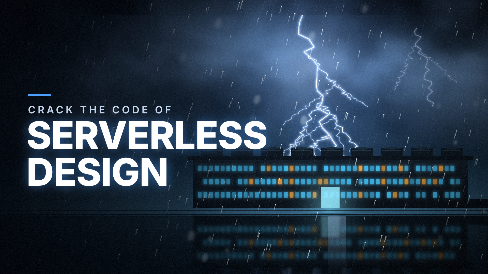

## Abstract
Ready to transform your approach to serverless architecture? In this immersive session, you'll do more than learn what design patterns are—you'll see them in action. You'll explore how each pattern operates through live, working demonstrations and discover actionable strategies for applying them in your projects today. From overcoming asynchronous challenges to perfecting error management, this session provides concrete takeaways you can implement immediately. Whether you're a seasoned architect or new to the serverless domain, join us to master the skills to elevate your cloud solutions to the next level.

# Type
- 45/60/75-minute session

## Learning Objectives
- Decode Live Serverless Patterns: Experience hands-on demonstrations that reveal the inner workings of each design pattern, turning abstract concepts into precise, practical blueprints.
- Turn Theory into Instant Impact: Acquire actionable strategies that immediately empower you to apply proven serverless tactics, boosting your projects with scalable and cost-efficient solutions.
- Elevate Your Cloud Craftsmanship: Master advanced techniques that refine your architecture skills, enabling you to build resilient, innovative, serverless applications that stand apart.

## Presentations

| Event | Location | Date | Time | Room | Downloads |
|-------|:--------:|-----:|-----:|-----:|----------:|
| [Live! 360](https://live360events.com/events/orlando-2026/sessions/wednesday/vsw10-serverless-design.aspx) | Orlando, FL | 18-NOV-2026 | 14:00 EDT | TBA | [Slides](EventMaterials/CrackTheCodeOfServerlessDesign-Live360.pdf) |

## Resources
There are no additional resources for this presentation.

Email [chadgreen@chadgreen.com](mailto:chadgreen@chadgreen.com?subject=Presentation%20Request:%20Presentation%20Title) to have Chad present this session at your event.